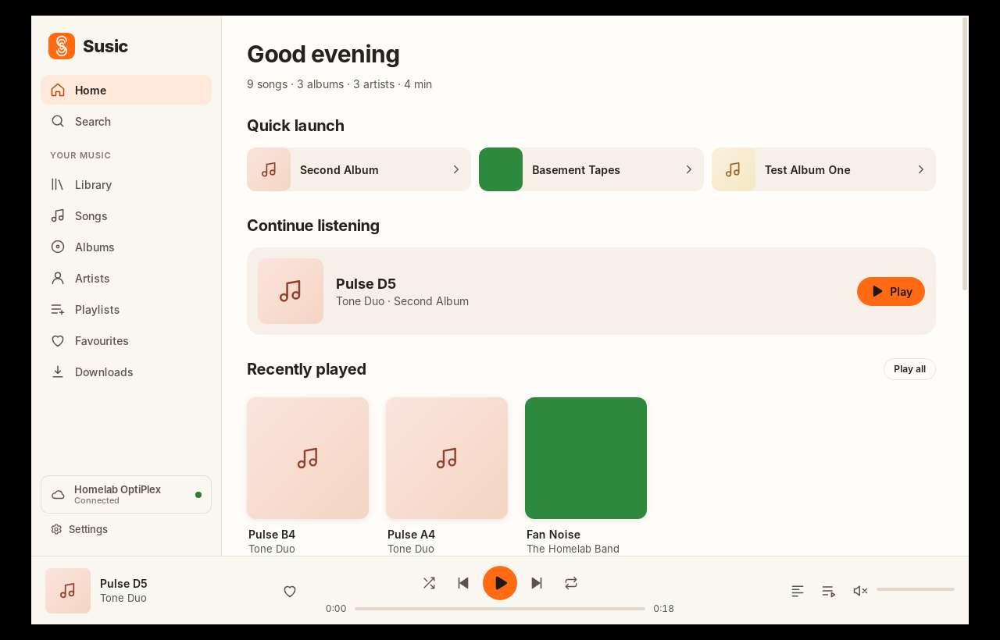
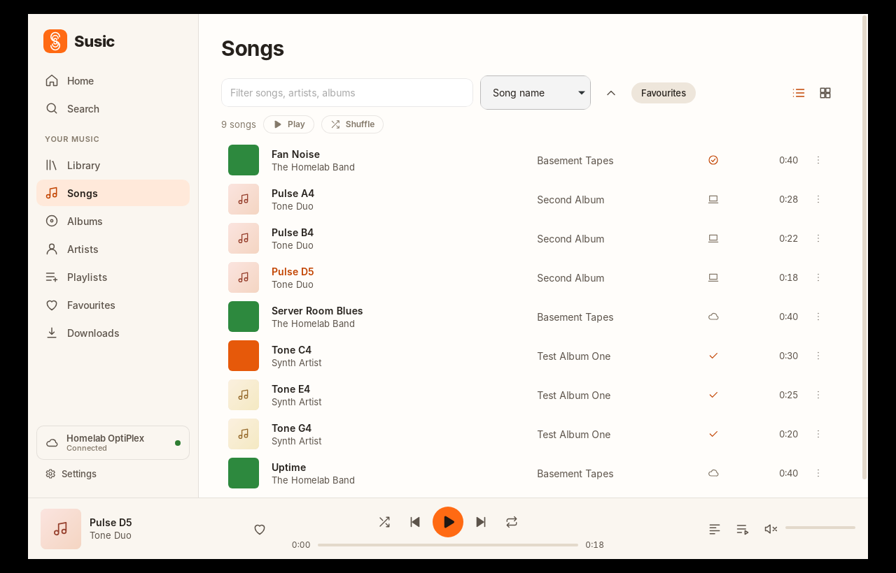
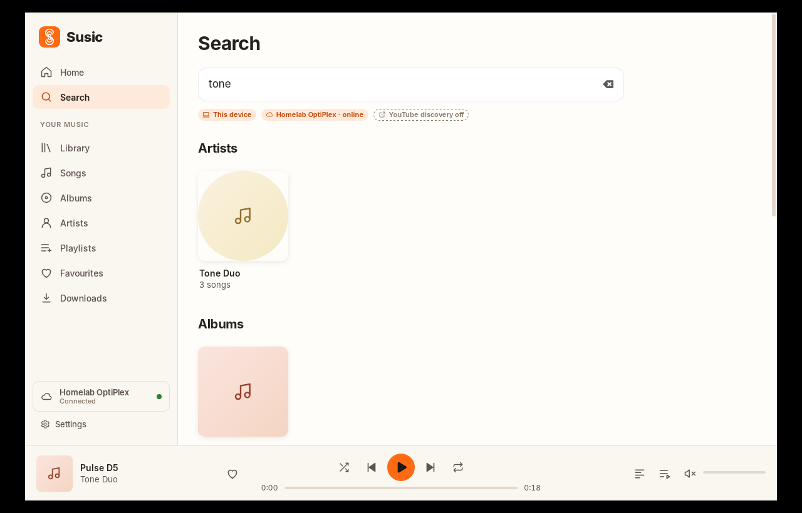
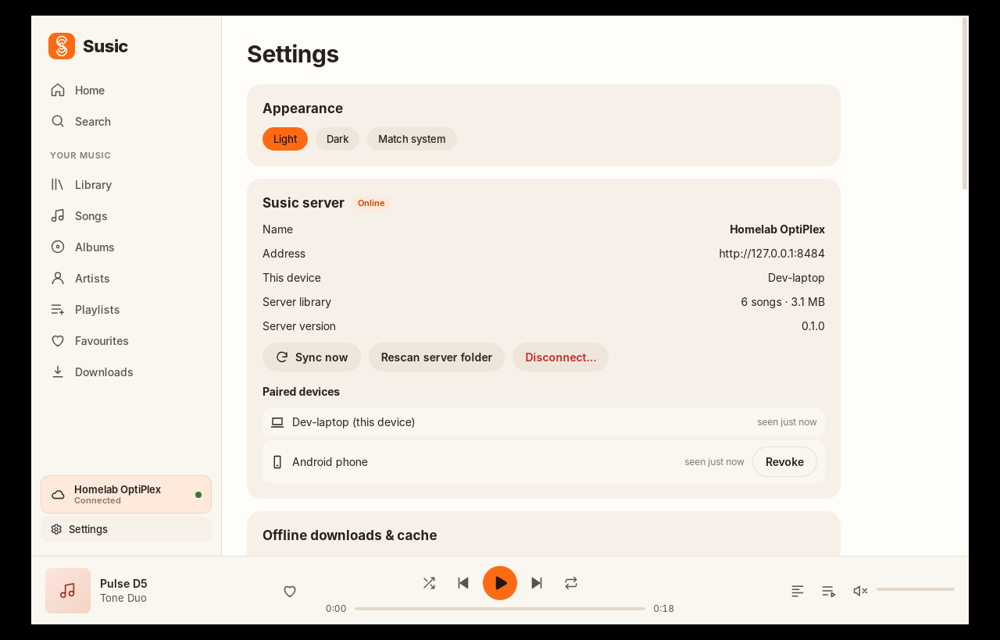
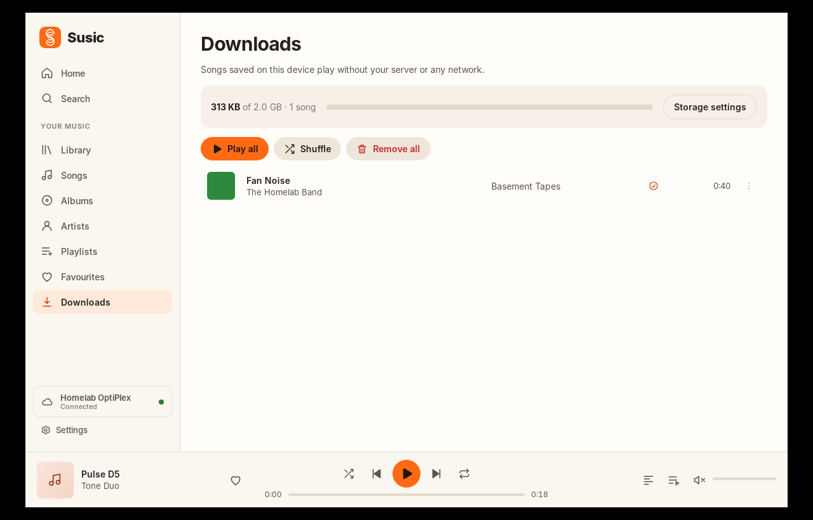
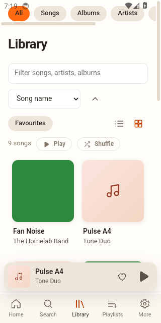

<p align="center"></p>

# Susic

A fast, private music player for Ubuntu and Android that treats your own music as first-class:
play local files, and optionally stream the library on your home server from anywhere through Tailscale.
No account, no telemetry. Your music stays yours.

> **Status: 0.2.0 (pre-release).** See [Known limitations](docs/KNOWN_LIMITATIONS.md) and the
> verification tables in [Android](docs/ANDROID.md) and [Server](docs/SERVER.md) for exactly what has
> and has not been tested.

| Home | Unified library | Search |
|---|---|---|
|  |  |  |

| Server settings | Downloads | Android |
|---|---|---|
|  |  |  |

## What it does

* **Local-first library** (SQLite): MP3, M4A/AAC, FLAC, WAV, Ogg Vorbis (Opus on Android), embedded tags,
  artwork and lyrics (embedded, `.lrc`, optional LRCLIB), albums/artists/playlists, favourites, play
  history, persistent queue and playback position, shuffle/repeat, media keys and MPRIS.
* **One library, two sources.** Songs stored on the device and songs on your Susic server appear in the
  same lists, with an indicator for *on this device*, *on your server*, *downloaded*, and
  *unavailable (server offline)*. A song you own locally is never streamed.
* **Optional self-hosted server** ([docs/SERVER.md](docs/SERVER.md)): a ~9 MB Rust binary for an old
  Ubuntu box. Indexes a directory, detects new/moved/deleted files, streams with seek, syncs favourites
  and playlists, runs under systemd.
* **Listen anywhere** over [Tailscale](docs/TAILSCALE.md) — never exposed to the public internet.
  Buffered streaming that reconnects and resumes, offline downloads with a size limit.
* **Unified search** across your device, your server and — as clearly-labelled *discovery only* results —
  YouTube's catalogue via the official API ([docs/YOUTUBE.md](docs/YOUTUBE.md)).
* **Home**: quick-launch speed dial (pin albums/artists/playlists), continue listening, recently played,
  frequently played, favourites.
* **Android**: Media3 background playback, notification, lock-screen/Bluetooth controls.
* Light theme by default (white, warm off-white, orange); optional dark theme.

## Install

**Ubuntu / Debian**

```bash
sudo apt install ./Susic_0.2.0_amd64.deb      # or run the .AppImage
```

**Android**: sideload the APK ([docs/ANDROID.md](docs/ANDROID.md)).

**Server** (optional): [docs/SERVER.md](docs/SERVER.md).

## Build from source

Requirements: Rust (stable), Node 20+, and on Ubuntu
`libwebkit2gtk-4.1-dev libgtk-3-dev libayatana-appindicator3-dev librsvg2-dev libasound2-dev libssl-dev libdbus-1-dev patchelf`.

```bash
cd apps/susic-app && npm ci
npm run tauri dev                         # desktop dev mode
npx tauri build --bundles deb,appimage    # → target/release/bundle/
cargo build --release -p susic-server     # → target/release/susic-server
```

## Run locally

```bash
# server (optional) — point it at any folder of music
SUSIC_MUSIC_DIR=~/Music SUSIC_DATA_DIR=/tmp/susic-srv SUSIC_BIND=127.0.0.1:8484 \
  cargo run -p susic-server -- serve
cargo run -p susic-server -- pair          # in another shell (same env): prints a pairing code
# app
cd apps/susic-app && npm run tauri dev     # Settings → Susic server → http://127.0.0.1:8484 + code
```

## Tests

```bash
cargo fmt --all -- --check && cargo clippy --workspace --all-targets -- -D warnings
cargo test --workspace                     # includes real-socket server/client integration tests
cargo test -p susic-app -- --ignored desktop_engine    # needs an audio device
cd apps/susic-app && npm run check && npm test
scripts/make-fixtures.sh ./fixtures        # synthetic test audio (ffmpeg)
```

## Layout

`crates/susic-core` (queue, models, lyrics) · `susic-library` (SQLite) · `susic-import` (tags, scan) ·
`susic-server` (server) · `susic-client` (server client, range reader) · `susic-sync` (device transfer) ·
`tauri-plugin-susic-player` (Android Media3) · `apps/susic-app` (Tauri + Svelte). See
[docs/ARCHITECTURE.md](docs/ARCHITECTURE.md).

## Documentation

[Server](docs/SERVER.md) · [Tailscale](docs/TAILSCALE.md) · [Security](docs/SECURITY.md) ·
[Android](docs/ANDROID.md) · [YouTube](docs/YOUTUBE.md) · [Privacy](docs/PRIVACY.md) ·
[Releasing & publication checklist](docs/RELEASING.md) · [Contributing](CONTRIBUTING.md) ·
[Third-party notices](THIRD_PARTY.md)

## Licence

GPL-3.0-or-later — see [LICENSE](LICENSE) and [docs/RELEASING.md](docs/RELEASING.md#licence).
