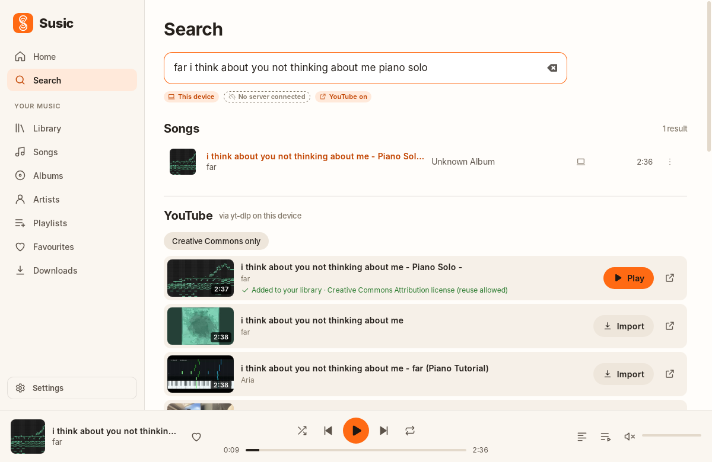
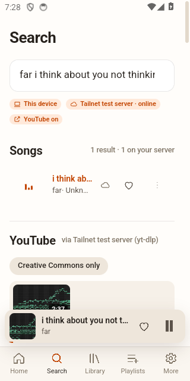

# YouTube search and import

Susic can search YouTube from its normal **Search** view and import music you have the right to download
into your library on this device or on your self-hosted Susic server. It uses
[yt-dlp](https://github.com/yt-dlp/yt-dlp) and FFmpeg. **No Google account or YouTube Data API key is
needed.** The feature is off until you turn it on (Settings → YouTube search & import, or the button in
Search).

| Desktop | Android (through your server) |
|---|---|
|  |  |

## Your responsibility

Only import content you are allowed to download, for example:

* your own uploads;
* works under a Creative Commons licence that permits reuse, or in the public domain;
* content whose rights holder permits downloading.

YouTube's Terms of Service restrict downloading content except where YouTube provides a download
feature or has the rights holder's permission. **You are responsible for how you use this feature.**
Susic asks you to confirm this once before the first import.

**What Susic does not do.** Susic never passes cookies or account credentials to yt-dlp. It never
tries to get around DRM, sign-in, age, membership, payment or region restrictions. Such videos fail
with a plain explanation, for example *"This item is DRM-protected. Susic does not bypass DRM, so it
can't be imported."*

**Licence information.** The **Creative Commons only** filter in Search applies YouTube's own search
filter. Each import records the licence the uploader declared (e.g. *Creative Commons Attribution
license (reuse allowed)*), and it is shown in the import queue. These declarations come from uploaders
and are **not verified** by Susic or YouTube. Re-uploads of commercial music are sometimes mislabelled.

## How it works

| | This computer (desktop) | Android |
|---|---|---|
| Search | yt-dlp `ytsearch` locally | through your Susic server's yt-dlp |
| Import to this device | yt-dlp + FFmpeg locally → library | not possible (yt-dlp can't run on Android) |
| Import to your server | the server runs yt-dlp → indexed → synced to every device | same |

1. **Search** (`yt-dlp --flat-playlist -J "ytsearch15:<query>"`) returns title, artist (or channel),
   thumbnail, duration and URL in about 2–4 s. Results appear under your own library results. yt-dlp
   searches have no quota, so Search runs them as you type (debounced). Only the search words are sent.
2. **Import** downloads the best audio stream and converts it with FFmpeg to your chosen format:
   M4A/AAC (default), MP3, FLAC, WAV, Opus, or *Original* (no re-encode, AAC preferred). For lossy
   formats you can pick 128–320 kbps or *Best*. yt-dlp writes tags (title, artist from the source's
   artist field or the channel name without " - Topic", date, source URL) and embeds the thumbnail,
   cropped square, as cover art. Susic then imports the file like any other: it reads the tags,
   duration and artwork. If artwork couldn't be embedded, the thumbnail is used instead.
3. **Progress and cancellation.** The import queue (Search rows and Downloads & Imports) shows
   download size, speed, time remaining and the conversion stages. **Cancel** stops yt-dlp and any
   FFmpeg it started straight away (the whole process group) and removes partial files. Imports run
   one at a time, refuse to start with under 2 GB free, and are stopped after 2 hours.
4. **Duplicates.** Files are named `Artist - Title [videoid].ext`. Importing the same video into the
   same folder again reuses the existing file instead of downloading it again.

> **Opus:** the desktop player (Symphonia) cannot decode Opus. Opus imports play on Android but not on
> desktop, so M4A is the default and *Original* prefers AAC.

## Installing and updating yt-dlp

* **One click (desktop):** Settings → YouTube → **Install**. Susic downloads the official standalone
  release for your platform from `github.com/yt-dlp/yt-dlp/releases` and checks it against the
  release's `SHA2-256SUMS`; nothing is installed if they don't match. The copy lives in Susic's data
  folder (`tools/`) and is used in preference to any yt-dlp on your PATH. **Update** fetches the
  latest verified release. Susic doesn't update anything on its own.
* **Your own copy:** `pipx install yt-dlp`, Homebrew, etc. Susic finds it on PATH (also
  `~/.local/bin`, `/usr/local/bin`, `/opt/homebrew/bin`). **Update** runs `yt-dlp -U`. Package-manager
  installs will tell you to update through the package manager.
* **FFmpeg** is required for imports (not for search): `sudo apt install ffmpeg`,
  `brew install ffmpeg`, `winget install Gyan.FFmpeg`.
* **JavaScript runtime (recommended):** recent yt-dlp releases use Deno or Node.js for YouTube. Susic
  passes the one it finds to yt-dlp. Without one, yt-dlp may find fewer audio formats.

YouTube changes often. If searches or imports start failing with *"yt-dlp couldn't read this page"*,
update yt-dlp first.

## Server setup

Server-side search and import are **off by default**. Turn them on in `/etc/susic/server.toml`:

```toml
ytdlp_enabled = true
imports_dir = "Susic Imports"   # sub-folder of music_dir that receives imports
```

then install yt-dlp and FFmpeg on the server:

```sh
sudo apt install ffmpeg
sudo -u susic susic-server --config /etc/susic/server.toml ytdlp-install   # verified managed copy
susic-server --config /etc/susic/server.toml check                         # shows yt-dlp/FFmpeg status
```

With this on, the server **writes new files** into `music_dir/imports_dir`, so that directory must be
writable by the server's user — under the shipped systemd unit that needs a one-line drop-in
(`ReadWritePaths="-/srv/music/Susic Imports"`; details and pitfalls in [SERVER.md](SERVER.md)). It
never changes or deletes existing files.

**Server limits** (all configurable, see [SERVER.md](SERVER.md)): imports only from YouTube hosts by
default (`import_hosts`), at most 20 queued imports, at least 2 GB kept free on the disk, 1 GiB per
file, 2 hours per import, and 2 concurrent searches (extra searches get "try again" rather than
waiting, so they can't slow down streaming). Imported tracks are indexed
right away and reach clients on their next sync (the app syncs as soon as the import finishes). Any
paired device can search and import, and can ask the server to update its yt-dlp
(`POST /api/v1/youtube/update`); revoke devices you don't trust. See [SERVER.md](SERVER.md) for the API.

## Errors you may see

| Message | Meaning |
|---|---|
| YouTube is rate-limiting this network / asking to prove it isn't a bot | Too many requests from your IP. Wait, then retry. Susic retries with back-off and never uses your account to get past this. |
| YouTube refused the download (HTTP 403) | Usually temporary. Susic retries once automatically. Update yt-dlp if it persists. |
| DRM-protected / members-only / purchase or rental / age-restricted / private / not available in your region | A platform restriction. Susic does not bypass it. |
| yt-dlp couldn't read this page | YouTube changed. Update yt-dlp. |
| Playlist import isn't supported | Import songs one at a time. |
| This server only imports from: … | The server's `import_hosts` doesn't include that site. |
| The server's import queue is full / Another search is still running | Server limits; wait a moment. |
| Not enough free space / The server is low on disk space | Imports keep 2 GB free (configurable). |
| The server can't write to its imports folder … | Server setup: see the systemd drop-in in SERVER.md. |
| The import took too long and was stopped | Time limit (2 h by default). |
| This file is larger than Susic's 1 GB import limit | Very long videos are refused. |

## Optional: official YouTube Data API

Settings → YouTube → backend **YouTube Data API (your key)** switches search to the official API
(`search.list`, 100 of your 10,000 daily quota units per search, so it searches only on Enter). It needs
a Google Cloud project with *YouTube Data API v3* enabled and a key. It offers nothing for importing,
and its results have no durations, so yt-dlp is the default. Imports always use yt-dlp. The key is
stored in the local settings database.
